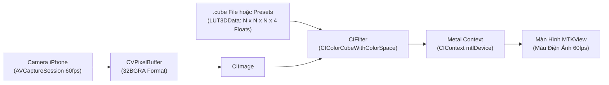

# Native 3D LUT Cinematic Camera Pipeline (iOS)

Dự án này triển khai toàn diện **Pipeline xử lý bảng màu điện ảnh 3D LUT thời gian thực** trên iOS sử dụng `AVFoundation`, `CoreImage` và `Metal GPU`.

---

## 1. Cấu Trúc Thành Phần

```text
lut-pipeline/
├── Package.swift                    # Cấu hình Swift Package
├── Resources/
│   └── SampleTealOrange.cube        # Tệp mẫu .cube 3D chuẩn Adobe / DaVinci
├── Sources/LUTPipeline/
│   ├── CubeLUTParser.swift          # Trình giải mã tệp .cube thành mảng RGBA Float32 Data
│   ├── LUTCameraProcessor.swift     # Xử lý luồng khung hình camera thời gian thực qua Metal
│   ├── CameraPreviewView.swift      # Metal MTKView & SwiftUI View hiển thị xem trước 60-120fps
│   └── Presets/
│       └── LUTPresets.swift         # Bộ sinh bảng màu thuật toán: Teal & Orange, Vintage Cafe, Gamma 3
└── Tests/LUTPipelineTests/
    └── CubeLUTParserTests.swift     # Bộ kiểm thử đơn vị tự động hóa với XCTest
```

---

## 2. Luồng Xử Lý Đồ Họa Thời Gian Thực (Pipeline Architecture)



1. **Chuẩn hóa dữ liệu màu:**
   * Tệp `.cube` chứa ma trận màu $N \times N \times N$.
   * `CubeLUTParser` chuyển đổi dữ liệu thành đối tượng `NSData` chứa mảng **RGBA Float32** (trong đó Alpha được gán cố định là 1.0).
2. **Áp màu qua GPU Metal:**
   * Sử dụng bộ lọc lõi của Apple `CIColorCubeWithColorSpace`.
   * Khung hình được xử lý trực tiếp trên GPU bằng `CIContext(mtlDevice:)`, đạt tốc độ 60 - 120 fps và không làm nóng máy.
3. **Chuyển đổi bảng màu tức thì (Hot-Swap):**
   * Cho phép người dùng chuyển đổi mượt mà giữa các tone màu (*Teal & Orange, Vintage Cafe, Life Cinema Gamma 3*) mà không gây giật khung hình.

---

## 3. Hướng Dẫn Sử Dụng Trong Ứng Dụng (SwiftUI Integration)

```swift
import SwiftUI
import LUTPipeline

struct ContentView: View {
    @StateObject private var processor = LUTCameraProcessor()

    var body: some View {
        ZStack {
            // 1. Màn hình Camera xem trước qua Metal GPU
            LUTCameraPreview(processor: processor)
                .ignoresSafeArea()

            VStack {
                // Tên bộ lọc hiện hành
                Text(processor.currentFilterName)
                    .font(.headline)
                    .foregroundColor(.white)
                    .padding(.horizontal, 16)
                    .padding(.vertical, 8)
                    .background(Color.black.opacity(0.6))
                    .cornerRadius(20)
                    .padding(.top, 40)

                Spacer()

                // 2. Thanh chọn nhanh bộ lọc màu điện ảnh
                ScrollView(.horizontal, showsIndicators: false) {
                    HStack(spacing: 12) {
                        Button("Gốc") {
                            processor.setLUT(nil)
                        }
                        .buttonStyle(FilterButtonStyle())

                        Button("Teal & Orange") {
                            processor.setLUT(LUTPresets.tealAndOrange(dimension: 32))
                        }
                        .buttonStyle(FilterButtonStyle())

                        Button("Vintage Cafe") {
                            processor.setLUT(LUTPresets.vintageCafe(dimension: 32))
                        }
                        .buttonStyle(FilterButtonStyle())

                        Button("Cinema Gamma 3") {
                            processor.setLUT(LUTPresets.filmCinemaGamma3(dimension: 32))
                        }
                        .buttonStyle(FilterButtonStyle())
                    }
                    .padding(.horizontal, 16)
                    .padding(.bottom, 30)
                }
            }
        }
        .onAppear {
            try? processor.setupCamera(position: .back)
            processor.startCapture()
        }
        .onDisappear {
            processor.stopCapture()
        }
    }
}

struct FilterButtonStyle: ButtonStyle {
    func makeBody(configuration: Configuration) -> some View {
        configuration.label
            .font(.subheadline)
            .fontWeight(.bold)
            .foregroundColor(.white)
            .padding(.horizontal, 16)
            .padding(.vertical, 10)
            .background(Color.white.opacity(0.25))
            .cornerRadius(16)
    }
}
```

---

## 4. Cách Nạp Tệp `.cube` Tùy Biến Từ Phần Mềm Dựng Phim

Nếu bạn có các tệp LUT xuất ra từ DaVinci Resolve, Adobe Premiere, hoặc Photoshop:

```swift
// Đọc từ tệp trong ứng dụng:
if let cubeURL = Bundle.main.url(forResource: "MyCustomGrade", withExtension: "cube") {
    let customLUT = try CubeLUTParser.parse(fileURL: cubeURL)
    processor.setLUT(customLUT)
}
```
